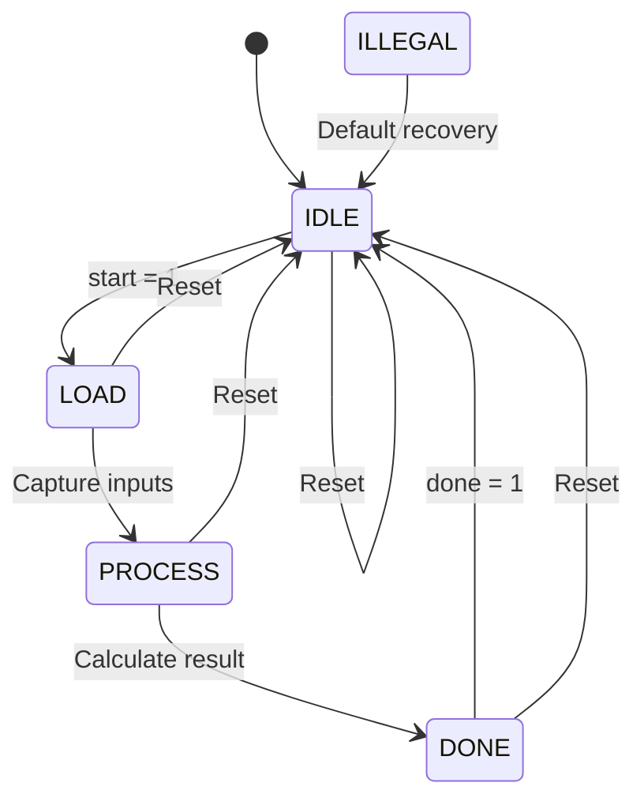
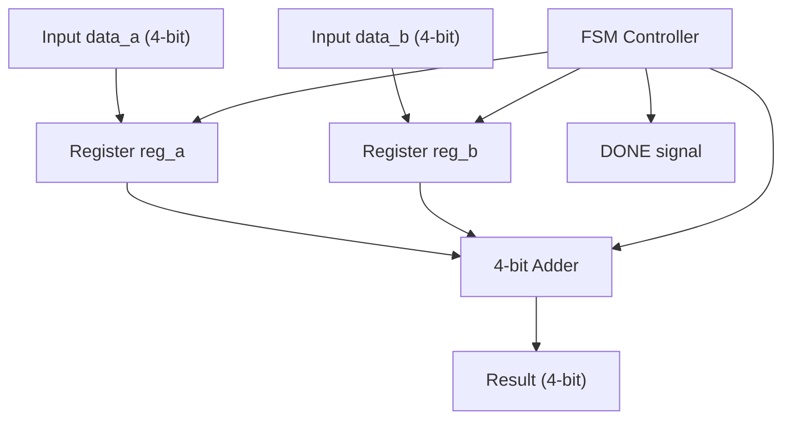

# FSM State Transition and Datapath Flow

## 1. FSM State Transition Diagram

The FSM contains four states:

- **IDLE (000):** Waits for the start signal.
- **LOAD (001):** Captures the two 4-bit input values.
- **PROCESS (010):** Adds the stored input values.
- **DONE (011):** Asserts the done signal and returns to IDLE.

## 2. Datapath Flow Diagram

The datapath consists of two 4-bit registers and an adder.

## 3. Example Operation

For the testbench inputs:

- data_a = 5
- data_b = 7

The FSM performs the following operations:

1. IDLE: Waits for start = 1.
2. LOAD: Stores 5 in reg_a and 7 in reg_b.
3. PROCESS: Adds reg_a and reg_b.
4. DONE: Produces result = 12 and asserts done.
5. Returns to IDLE.

## 4. Reset and Recovery

- A synchronous active-high reset returns the FSM to IDLE.
- Reset clears both internal registers, result and done.
- An illegal state such as 111 triggers the default recovery logic and returns the FSM to IDLE.
- The testbench verifies reset recovery and illegal-state recovery.

## 5. Verification Result

All FSM testbench checks passed, including reset, legal state transitions, datapath register capture, arithmetic result, DONE signal, illegal-state recovery and reset during operation.

**Simulation status: ALL FSM ASSERTIONS AND TESTS PASSED!**

